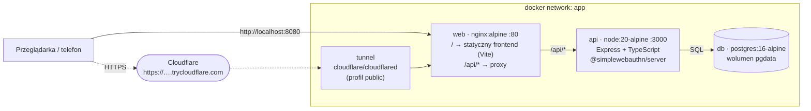
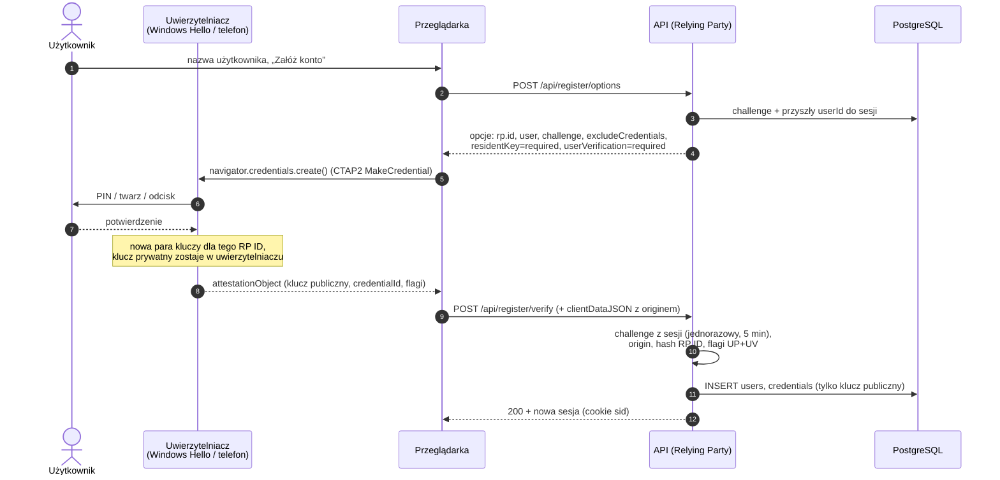
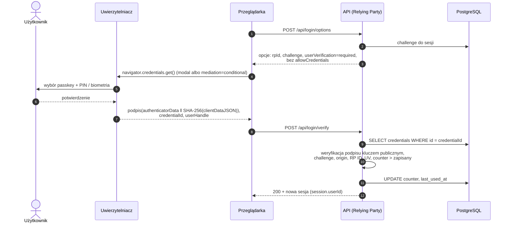

# fido-passkeys-demo

Testowe wdrożenie logowania bez hasła zgodnego z **FIDO2 (WebAuthn + CTAP)**. Aplikacja sama pełni rolę
Relying Party (biblioteka [SimpleWebAuthn](https://simplewebauthn.dev/)), bez usług zewnętrznych. Całość działa w Docker Compose.

Testowane uwierzytelniacze: **Windows Hello** oraz **passkeys w telefonie** (Android / iOS – zapis na
telefonie i logowanie z komputera kodem QR).

## Szybki start

```bash
docker compose up --build
```

Potem otwórz <http://localhost:8080>. `localhost` jest traktowany przez przeglądarki jako bezpieczny
kontekst, więc WebAuthn działa bez HTTPS (`RP_ID=localhost`). Plik `.env` nie jest wymagany – wartości
domyślne są w `docker-compose.yml`; własne ustawienia: skopiuj `.env.example` do `.env`.

| Polecenie | Co robi |
| --- | --- |
| `docker compose up --build` | baza, API i frontend pod `http://localhost:8080` |
| `docker compose ps` | stan kontenerów (wszystkie mają być `healthy`) |
| `docker compose --profile test run --rm api-test` | testy API (Vitest + supertest) na osobnej bazie `fido_test` |
| `docker compose --profile public up -d` | dodatkowo tunel HTTPS dla telefonów |
| `docker compose down -v` | zatrzymanie i **skasowanie danych** (wolumen `pgdata`) |

## Architektura



- **Jeden origin** (nginx): frontend i API są pod tym samym adresem, więc nie ma CORS, a cookie sesji jest
  `HttpOnly`, `SameSite=Lax` i – za tunelem – `Secure`.
- **Baza nie jest dostępna z zewnątrz**: port 5432 nie jest wystawiony na hosta (do debugowania:
  `docker-compose.override.example.yml`).
- **API jest bezstanowe**: sesje i challenge leżą w Postgresie (`connect-pg-simple`), więc restart kontenera
  `api` nikogo nie wylogowuje.
- Migracje (`api/migrations/*.sql`) uruchamiają się przy starcie API.

### Struktura repo

```
docker-compose.yml          web, api, db, tunnel (profil public), api-test (profil test)
.env.example                RP_ID, ORIGIN, RP_NAME, SESSION_SECRET, POSTGRES_*
web/
  Dockerfile                multi-stage: Vite build → nginx:alpine
  nginx.conf                statyczne pliki + proxy /api, nagłówki bezpieczeństwa (CSP itd.)
  src/main.ts               UI: rejestracja, logowanie, panel passkeys
  src/passkeys.ts           @simplewebauthn/browser, klient API, komunikaty błędów
api/
  Dockerfile                multi-stage: build TS → node:20-alpine, użytkownik non-root
  src/server.ts             start: czekanie na bazę, migracje, nasłuch
  src/app.ts                Express, sesje, routing, /healthz
  src/webauthn.ts           4 handlery ceremonii WebAuthn
  src/config.ts             konfiguracja RP z env
  src/db.ts                 pg Pool, migracje, zapytania
  migrations/001_init.sql   users, credentials, session
  test/                     Vitest + supertest + programowy uwierzytelniacz
```

### Model danych

- `users(id uuid pk, username text unique, created_at)`
- `credentials(id text pk` – credentialID w base64url`, user_id fk, public_key bytea, counter bigint,
  transports text[], device_type, backed_up, aaguid uuid, name, created_at, last_used_at)`
- `session` – tabela `connect-pg-simple`; challenge jest częścią danych sesji.

### API

| Metoda i ścieżka | Opis |
| --- | --- |
| `POST /api/register/options` | opcje rejestracji; `{ username }` dla nowego konta, bez body dla zalogowanego |
| `POST /api/register/verify` | weryfikacja attestation, zapis passkey, zalogowanie |
| `POST /api/login/options` | opcje logowania (bez `allowCredentials`) |
| `POST /api/login/verify` | weryfikacja asercji, aktualizacja `counter` i `last_used_at`, sesja |
| `GET /api/me`, `POST /api/logout` | bieżący użytkownik, wylogowanie |
| `GET /api/credentials`, `DELETE /api/credentials/:id` | lista passkeys, usunięcie (nie ostatniego) |
| `GET /api/healthz` | healthcheck (sprawdza też bazę) |

## Jak to działa

### Rejestracja



### Logowanie (bez loginu, przycisk lub autofill)



W scenariuszu **QR + Bluetooth** (hybrid transport) krok 4–7 odbywa się na telefonie: komputer wyświetla kod
QR, telefon łączy się przez tunel i potwierdza bliskość przez Bluetooth, a passkey nie trafia na komputer.

### Odporność na phishing

1. **Powiązanie z originem.** Uwierzytelniacz tworzy klucz dla konkretnego RP ID, a przeglądarka wpisuje do
   podpisywanego `clientDataJSON` faktyczny origin strony. Na stronie-podróbce (`evil.example`) przeglądarka w
   ogóle nie zaproponuje passkey dla naszej domeny, a gdyby ktoś spreparował odpowiedź – serwer odrzuci ją,
   bo origin i hash RP ID nie zgadzają się z konfiguracją (testy „zły origin” w `api/test`).
2. **Serwer trzyma tylko klucz publiczny.** Klucz prywatny nie opuszcza uwierzytelniacza (lub zaszyfrowanej
   synchronizacji dostawcy). Wyciek bazy nie daje nic, czym dałoby się zalogować – nie ma haseł ani sekretów
   współdzielonych.
3. **Jednorazowy challenge.** Każda ceremonia podpisuje świeży losowy challenge, który serwer zdejmuje z
   sesji przy pierwszej próbie weryfikacji i który wygasa po 5 minutach – przechwyconej odpowiedzi nie da się
   odtworzyć.
4. **Weryfikacja użytkownika.** `userVerification: required` – sam dostęp do urządzenia nie wystarcza,
   potrzebny jest PIN lub biometria (dwa składniki w jednym kroku: posiadanie + wiedza/cecha).
5. **Licznik podpisów.** Cofnięty `counter` (sklonowany uwierzytelniacz) powoduje odrzucenie logowania.
   Passkeys synchronizowane zwykle raportują 0 – wtedy to sprawdzenie jest pomijane.

Świadome uproszczenia wersji demo: brak rate limitingu, `POST /api/register/options` zdradza, czy nazwa
użytkownika jest zajęta, nie ma odzyskiwania konta, attestation jest wyłączone (`none`).

## HTTPS dla telefonów (tunel)

Telefon nie widzi `localhost`, a WebAuthn poza `localhost` wymaga HTTPS – stąd kontener `tunnel`.

1. Uruchom wszystko z tunelem:
   ```bash
   docker compose --profile public up -d --build
   ```
2. Odczytaj wylosowany adres `https://….trycloudflare.com`:
   ```bash
   docker compose logs tunnel
   ```
3. Wpisz go do `.env` (domena bez schematu w `RP_ID`, pełny adres w `ORIGIN`) i ustaw własny
   `SESSION_SECRET`:
   ```
   RP_ID=przykladowa-nazwa.trycloudflare.com
   ORIGIN=https://przykladowa-nazwa.trycloudflare.com
   ```
4. Odtwórz **tylko** kontener API (tunel ma działać dalej):
   ```bash
   docker compose up -d api
   ```
5. Otwórz adres tunelu na telefonie i na komputerze.

> **Uwaga.** Quick tunnel losuje domenę przy każdym starcie kontenera `tunnel`, a passkeys są trwale
> przypisane do RP ID. Na czas testów T3–T5 tunel musi działać bez przerwy – po jego restarcie zmienia się
> adres i wcześniej utworzone passkeys przestają pasować (te dla `localhost` też są osobne). Stała domena
> wymaga nazwanego tunelu Cloudflare z własną domeną. Strona sama ostrzega, gdy adres w przeglądarce nie
> zgadza się z `ORIGIN` serwera.

## Testy

### Automatyczne (API)

```bash
docker compose --profile test run --rm api-test
```

Vitest + supertest na osobnej bazie `fido_test` (tworzonej automatycznie). Prawdziwy uwierzytelniacz
zastępuje `api/test/softAuthenticator.ts`: generuje klucze ES256, buduje `attestationObject` i podpisuje
asercje, więc testy przechodzą pełne ceremonie – łącznie z negatywnymi (zły origin, powtórzona odpowiedź,
wygasły challenge, cofnięty licznik, usunięty passkey).

Testy są uruchamiane z etapu `build` obrazu API (profil `test`), a nie przez `docker compose run api npm test`,
bo obraz produkcyjny nie zawiera zależności deweloperskich.

### Ręczne bez sprzętu

Chrome DevTools → *More tools* → **WebAuthn** → *Enable virtual authenticator environment* → dodaj
uwierzytelniacz: protokół `ctap2`, transport `internal`, zaznaczone *Supports resident keys* i
*Supports user verification*.

### Scenariusze i wyniki

Kolumna „Automat” – pokrycie logiki serwera testami z `api/test` (stan: 21/21 zalicza). Kolumnę „Ręcznie”
uzupełniamy po przejściu scenariusza na prawdziwym urządzeniu.

| # | Scenariusz | Oczekiwany wynik | Automat | Ręcznie (data, urządzenie, wynik) |
| --- | --- | --- | --- | --- |
| T1 | Rejestracja przez Windows Hello (PIN / twarz / odcisk) w Chrome i Edge | rekord w `credentials` | ✅ logika serwera | |
| T2 | Logowanie Windows Hello: przycisk i autofill | sesja aktywna, `counter` zaktualizowany | ✅ logika serwera | |
| T3 | Rejestracja i logowanie na Androidzie (Google Password Manager) | `backed_up = true` | ✅ flagi BE/BS | |
| T4 | Rejestracja i logowanie na iPhone (iCloud Keychain, Safari) | jak wyżej | – | |
| T5 | Logowanie na PC passkeyem z telefonu (QR + Bluetooth) | sukces bez passkey na PC | – | |
| T6 | Kilka passkeys na koncie, usunięcie jednego | usunięty przestaje działać | ✅ | |
| T7 | Negatywne: anulowanie, zły origin, ponownie użyty lub wygasły challenge | odrzucenie przez API | ✅ (poza anulowaniem w UI) | |
| T8 | Ponowna rejestracja tego samego urządzenia | blokada przez `excludeCredentials` | ✅ | |
| T9 | Restart kontenerów `api` i `db` | dane i passkeys zachowane (wolumen), logowanie działa | ✅ sesja z bazy | |

Podpowiedzi do testów ręcznych:

- **T2 autofill:** kliknij pole „Nazwa użytkownika” – przeglądarka pokaże passkeys zapisane dla tej domeny.
- **T5:** na komputerze „Zaloguj się passkeyem” → w oknie systemowym wybierz telefon / inne urządzenie →
  zeskanuj kod QR; Bluetooth musi być włączony na obu urządzeniach.
- **T7 zły origin:** ustaw w `.env` inny `ORIGIN` niż adres w przeglądarce i wykonaj `docker compose up -d api`.
- **T9:** `docker compose restart db api`, potem odśwież stronę (sesja zostaje) i zaloguj się ponownie.
- Podgląd bazy: `docker compose exec db psql -U fido -d fido -c "select name, device_type, backed_up, counter, last_used_at from credentials"`.
- Usunięcie passkey w panelu kasuje go po stronie serwera; wpis w Windows Hello / menedżerze haseł telefonu
  usuwa się osobno w ustawieniach urządzenia.
